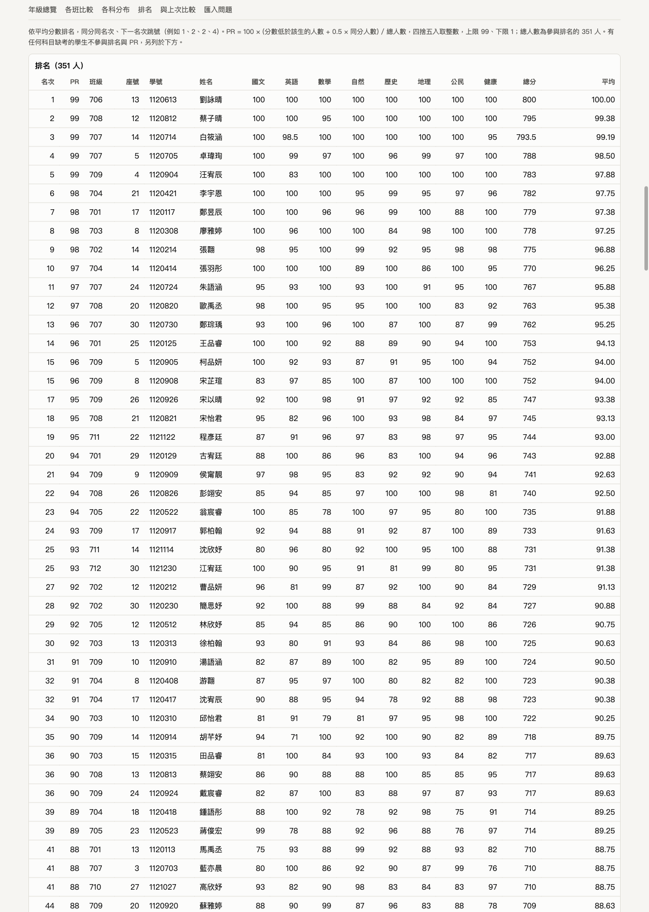
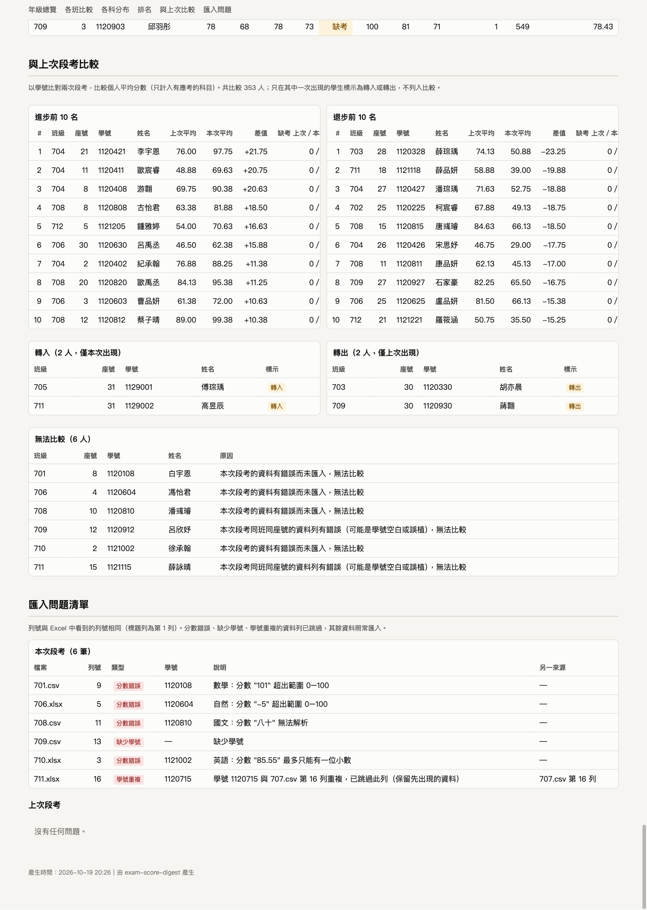
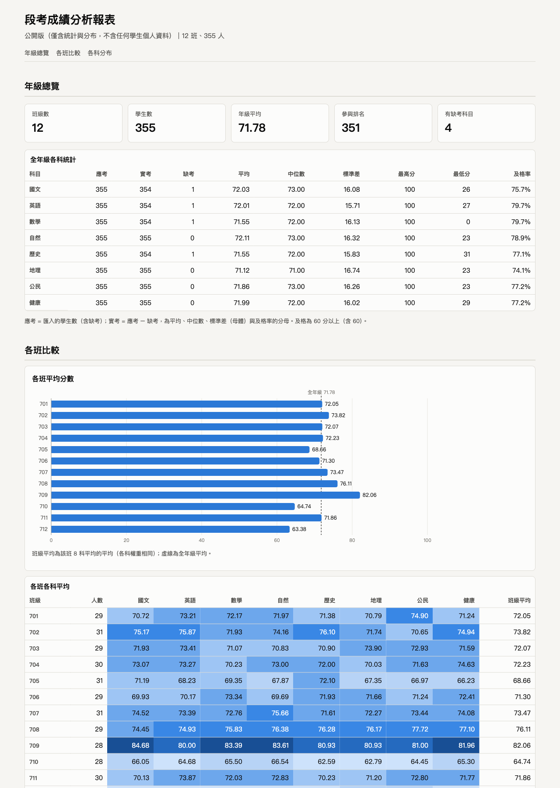

# Exam Score Digest — 國中段考成績彙整與分析工具

把各班導師交來的成績檔（校務系統匯出、或導師用 Excel 修改後另存的 CSV／.xlsx）
放進同一個資料夾，一個指令產出：

- **HTML 報表**：年級總覽、各班比較、各科分布圖、排名與 PR、與上次段考比較、匯入問題清單。
  單一檔案、可離線開啟，圖表為內嵌 SVG，不載入任何外部資源。
- **.xlsx 成績總表**：全年級一個工作表，再加上每班一個工作表。
- **公開版報表**（`--public`）：可張貼公告，只有統計與分布，不含姓名、學號與個人分數。

## 安裝與使用

需求：Node.js 22.12 以上（22 LTS 或更新版本）。

```bash
npm install
npx exam-digest build sample-data/current --prev sample-data/previous --out out
```

`npm install` 會自動編譯 TypeScript（`prepare` script），完成後即可使用 `exam-digest` 指令。
上面的指令會用範例資料產出 `out/exam-report.html` 與 `out/exam-scores.xlsx`。

產生公開版：

```bash
npx exam-digest build sample-data/current --out out --public
```

### CLI 參數

```
exam-digest build <資料夾> [--prev <上次資料夾>] [--out <輸出資料夾>] [--config <設定檔>] [--public]
```

| 參數 | 說明 | 預設 |
|---|---|---|
| `<資料夾>` | 本次段考成績檔所在資料夾，讀取其中所有 `.csv` 與 `.xlsx`（略過 `~$` 開頭的 Excel 暫存檔） | 必填 |
| `--prev <資料夾>` | 上一次段考的資料夾；有指定才產生「與上次段考比較」 | 無 |
| `--out <資料夾>` | 輸出資料夾，不存在會自動建立 | `out` |
| `--config <檔案>` | 科目對應設定檔 | 內建 `config/subjects.json` |
| `--public` | 只輸出公開版 `exam-report-public.html`，不輸出 xlsx 總表 | 否 |

輸出檔案：

| 模式 | 檔案 |
|---|---|
| 一般 | `exam-report.html`、`exam-scores.xlsx` |
| `--public` | `exam-report-public.html` |

Exit code：`0` 成功（即使有資料列問題，問題會列在報表中）、`1` 無法繼續的錯誤（資料夾不存在、設定檔格式錯誤、資料夾中沒有成績檔）、`2` 參數錯誤。

### 成績檔格式

- 第一列為欄位名稱，欄位包含：班級、座號、學號、姓名、8 科分數。
- 沒有「班級」欄時，從檔名中的三位數字取得班級（例如 `701.csv`、`七年級-712班.xlsx`）。
- CSV 自動辨識編碼：UTF-8（含或不含 BOM）與 Big5／CP950（校務系統匯出、Excel「CSV（逗號分隔）」另存）。
- .xlsx 只讀第一個工作表；公式欄位取計算結果。
- 欄名比對會忽略全形／半形差異與空白（「座　號」＝「座號」），分數中的全形數字也會轉為半形。

## 科目對應設定檔

`config/subjects.json`（可用 `--config` 指定其他檔案）：

```json
{
  "subjects": [
    { "name": "國文", "aliases": ["國語文", "國語"] },
    { "name": "英語", "aliases": ["英文", "英語文"] },
    { "name": "數學", "aliases": ["數學科"] },
    { "name": "自然", "aliases": ["自然科學", "自然與生活科技"] },
    { "name": "歷史", "aliases": ["歷史科"] },
    { "name": "地理", "aliases": ["地理科"] },
    { "name": "公民", "aliases": ["公民與社會", "公民科"] },
    { "name": "健康", "aliases": ["健康教育", "健教"] }
  ],
  "fields": {
    "className": ["班級", "班別"],
    "seat": ["座號"],
    "studentId": ["學號"],
    "name": ["姓名", "學生姓名"]
  },
  "ignoreColumns": ["總分", "平均", "名次", "備註"],
  "absentTokens": ["缺", "缺考"]
}
```

| 欄位 | 必填 | 說明 |
|---|---|---|
| `subjects` | 是 | 剛好 8 科。`name` 是報表中顯示的標準科目名稱，`aliases` 是各班可能使用的其他欄名 |
| `fields` | 否 | 班級、座號、學號、姓名欄可接受的欄名 |
| `ignoreColumns` | 否 | 導師自行加上的欄位（如總分公式），直接忽略、不列為問題 |
| `absentTokens` | 否 | 代表缺考的文字；空白一律視為缺考 |

所有科目名稱與別名不得重複，否則會在開始前報錯。成績檔中有設定檔裡不認得的欄位時，
會在問題清單中列出並忽略該欄；缺少必要欄位（學號、姓名或任一科）時，整個檔案不匯入並列入問題清單。

## 計算規則

### 缺考與資料驗證

- 分數欄為「缺」、「缺考」或空白，視為**缺考**。缺考與 0 分是不同的：0 分計入統計，缺考不計入。
- 有效分數為 0–100，最多一位小數（`85.5` 可以，`85.55` 不行）。
- 以下情況會**跳過整列**，並在「匯入問題清單」列出檔名、列號與原因，其餘資料照常匯入：
  - 分數超出範圍或無法解析（例如 `101`、`-5`、`八十`）
  - 缺少學號
  - 學號在多個檔案中重複：依檔名順序保留第一筆，之後的重複列跳過；問題清單列出兩個來源的檔名與列號，報表中保留的那位學生標示「學號重複」
- 列號與 Excel 中看到的列號相同：標題列為第 1 列，第一筆資料為第 2 列。
- 完全空白的列（Excel 常見的殘留列）直接略過，不列為問題。

### 統計

| 項目 | 規則 |
|---|---|
| 應考人數 | 成功匯入的學生數（含缺考） |
| 實考人數 | 應考 − 缺考，也是平均、中位數、標準差、及格率的分母 |
| 平均 | 實考學生分數總和 ÷ 實考人數 |
| 中位數 | 實考人數為偶數時取中間兩數的平均 |
| 標準差 | 母體標準差（除以 N），等同 Excel `STDEV.P` |
| 及格率 | 60 分以上（含 60）的人數 ÷ 實考人數 |
| 個人總分／平均 | 只計入有應考的科目；平均 = 總分 ÷ 實考科目數，並標示缺考科目數 |
| 班級平均 | 該班 8 科平均的平均（各科權重相同） |

### 排名與 PR 值

- 只有 **8 科全部應考** 的學生參與排名；有任何科目缺考的學生另外列出，不參與排名與 PR。
- 依平均分數由高到低排名，**同分同名次，下一名次跳號**（例如 1、2、2、4）。
- **PR = 100 × (分數低於該生的人數 + 0.5 × 同分人數) / 總人數**，同分人數含本人、總人數為參與排名的人數；
  四捨五入取整數，上限 99、下限 1。
  - 例：4 人分數為 90、85、85、80 → PR 分別為 88（87.5）、50、50、13（12.5）。
- 分數在程式內部以「十分位整數」儲存（85.5 → 855），同分判定完全精確，不會因浮點誤差把同分判成不同分。

### 分數分布

每科以 10 分為一個級距：

| 級距 | 0–9 | 10–19 | … | 80–89 | 90–100 |
|---|---|---|---|---|---|
| 邊界 | 0 ≤ 分數 < 10 | 10 ≤ 分數 < 20 | … | 80 ≤ 分數 < 90 | 90 ≤ 分數 ≤ 100 |

89.9 分屬於 80–89；100 分併入最後一級 90–100。缺考不計入。

### 與上次段考比較

- 以學號比對，比較兩次的個人平均分數（只計入有應考的科目），差值 = 本次平均 − 上次平均。
- 列出進步、退步各前 10 名；同差值時依學號排序。只列真正進步（或退步）的學生，不足 10 人時列出實際人數。
- 有缺考科目的學生也納入比較，表格中標示兩次的缺考科目數。
- 只在本次出現的學生標示「轉入」、只在上次出現的標示「轉出」，不列入比較。
- 若學號只出現在一次，但另一次「同一學號」或「同班同座號」的資料列因錯誤被跳過，
  會標示為「無法比較」並說明原因，而不是誤判為轉學（例如本次學號欄空白或誤植成別人的學號）。

## 報表截圖

完整版（排名區）：



完整版（與上次比較、匯入問題清單）：



公開版：



## 範例資料

`sample-data/` 由 `npm run sample`（`scripts/generate-sample.ts`）產生，固定亂數種子，可重現。

- `current/`：本次段考，12 班、每班 29–31 人、8 科。
  - 校務系統匯出：701–703 為 Big5 CSV、704–706 為 xlsx，有班級欄、使用標準欄名。
  - 導師 Excel 另存：707–708 為 Big5 CSV、709 為 UTF-8 BOM CSV、710–712 為 xlsx；
    沒有班級欄（由檔名判斷）、使用「國語文」「英文」等別名、學號存成數字、多一欄總分公式、尾端有空白列、含全形數字。
- `previous/`：上次段考，用於比較功能。
- 刻意放入的異常：缺考（缺／缺考／空白）、0 分、`101`、`-5`、`八十`、`85.55`、空學號、跨檔重複學號、轉入 2 人、轉出 2 人。

## 開發

```bash
npm test          # Vitest 單元與整合測試
npm run lint      # ESLint（typescript-eslint strictTypeChecked）
npm run typecheck # tsc --noEmit
npm run build     # 編譯到 dist/
npm run sample    # 重新產生範例資料
```

架構與設計決策見 [`docs/DESIGN.md`](docs/DESIGN.md)；驗收測試結果見 [`docs/TEST-REPORT.md`](docs/TEST-REPORT.md)。

```bash
npm run verify    # 黑箱驗收腳本：執行 CLI 後從輸出檔獨立重算並比對
```主要流程：

```
讀檔（編碼偵測）→ 欄名對應與資料驗證 → 重複學號檢查 → 統計／排名／分布／比較
→ ReportModel ─┬→ 完整版 HTML、xlsx 總表
               └→ PublicReportModel（型別上沒有個人資料）→ 公開版 HTML
```

## 已知限制

- 只支援 `.csv` 與 `.xlsx`，不支援舊版 `.xls`；xlsx 只讀第一個工作表。
- CSV 只自動辨識 UTF-8 與 Big5（CP950）。若導師存檔時罕用字已被 Excel 轉成「?」，工具無法還原。
- 學號若在 Excel 中被存成數字，前導 0 會在導師端就遺失，工具只能照存下的數字比對。
- 班級從欄位或檔名中的第一組三位數字取得，班級名稱不是三位數字（例如「七年一班」）時，需要在成績檔中提供班級欄。
- 學號重複時保留檔名排序在前的那一筆；工具無法判斷哪一筆才是正確的，需由組長查看問題清單後修正原始檔。
- 「同班同座號」的轉學誤判防護需要該列有座號；座號也空白時，仍可能被標示為轉入／轉出。
- 公開版不包含任何學生層級的清單（依需求討論的決議）；學號遮罩函式（只顯示末三碼）已實作並測試，但目前沒有用到。
- 報表只在最新版 Chrome 與 Edge 上驗證過；圖表 hover 使用瀏覽器原生的 SVG tooltip。
- 依賴套件：`npm audit` 會回報 ExcelJS 依賴的 `uuid@8` 有 moderate 漏洞（GHSA-w5hq-g745-h8pq），
  該漏洞只在呼叫 v3/v5/v6 並傳入 buffer 時觸發；ExcelJS 只呼叫不帶參數的 `v4()`，實際不受影響。
  `npm audit fix --force` 會把 ExcelJS 降級到 3.4，因此沒有採用。
- 在 macOS 上用 npm 11 安裝時，可能出現 `fsevents` install script 未核准的警告；
  它是 Vitest 監看檔案用的選用依賴，不影響建置、測試與 CLI。
- 範例資料中 xlsx 檔每次重新產生時位元組會不同（ExcelJS 會在 zip 中寫入產生時間），內容本身不變。
